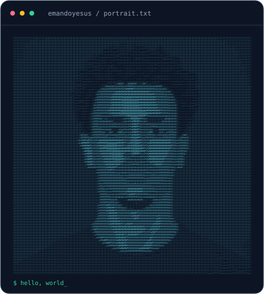
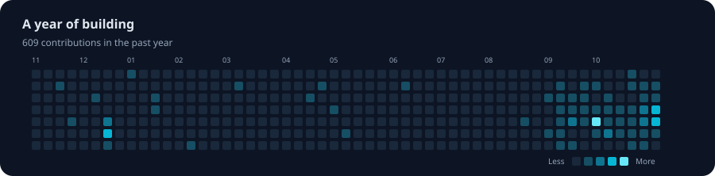

**From the first component to the final API.**

---

### 01 / Behind the code

<table>
<tr>
<td width="52%" valign="top">

**Hey, I'm Emandoyesus 👋**

I build fullstack web and mobile applications, connecting thoughtful interfaces with reliable backends.

My everyday toolkit is **React, React Native, Node.js, and PostgreSQL**. I care about clean architecture, type safety, and shipping work that holds up in production.

**Currently:** building web and mobile products. 
**Ask me about:** React, React Native, or Node.js.

</td>
<td width="48%" valign="middle">

</td>
</tr>
</table>

### 02 / My toolkit

  
  
  
  
  
  
  
  

TypeScript · React · React Native · Node.js · Tailwind CSS · PostgreSQL · Docker · Git

| Interfaces | Behind the scenes | How I build |
| :--- | :--- | :--- |
| Web & mobile experiences | APIs & application data | Type-safe code |
| React & React Native | Node.js & PostgreSQL | Clean architecture |

### 03 / The commit trail

A year of building, one contribution at a time. Refreshed daily from GitHub.

### 04 / Let’s connect

---

<b>Thoughtfully designed. Carefully built. Always improving.</b>

<!-- Maintenance: .github/workflows/activity.yml generates the real contribution
calendar after pushing, then refreshes daily. You can also run it from Actions.
Local SVG animations respect prefers-reduced-motion. Portfolio and Telegram links are supplied by the profile owner. -->
