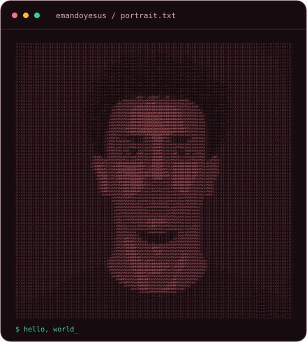
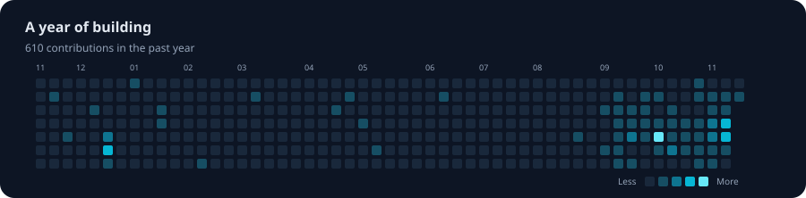

# Emandoyesus Tesfaye

**Full-stack web & mobile developer** · interfaces, APIs, and the data behind them.

---

## Who am I?

<table>
<tr>
<td width="52%" valign="top">

### I build applications end to end — from the first interface to the API and database behind it.

**What drives me**  
I like the moment an idea becomes something people can actually use, and I care about the details that make it last.

 

**Approach**  
> My work leans toward **clean architecture, type safety, and reliable backends**. Each project is a chance to sharpen those instincts and make the next version better.

 

**Focus**  
TypeScript · React · React Native · Node.js · PostgreSQL

</td>
<td width="48%" valign="middle">

</td>
</tr>
</table>

---

## Tech stack

<strong>Frontend</strong>

  
  
  
  
  

<strong>Backend &amp; data</strong>

  
  

<strong>Tooling</strong>

  
  

---

## Selected projects

<table>
<tr>
<td width="50%" valign="top">

### [All-Nighter](https://github.com/emandoyesus/All-Nighter)

A shared late-night focus room with synchronized music, live chat, and a countdown to sunrise.

<code>SvelteKit</code> <code>Tailwind CSS</code> <code>MQTT</code>

</td>
<td width="50%" valign="top">

### [Addisalem Film Academy](https://github.com/emandoyesus/Addisalem-Film-Academy)

A film academy site with program discovery, enrollment applications, a studio portfolio, and an admin console.

<code>React</code> <code>TypeScript</code> <code>Firebase</code>

</td>
</tr>
<tr>
<td width="50%" valign="top">

### [Movie Explorer — AXORA](https://github.com/emandoyesus/Movie-Explorer)

A movie discovery platform with live search, trailers, and personal watchlists.

<code>React</code> <code>Node.js</code> <code>PostgreSQL</code> <code>TMDB API</code>

</td>
<td width="50%" valign="top">

### [Java EMS](https://github.com/emandoyesus/Java-EMS)

A collaborative employee management system with a JavaFX interface, client-server communication over RMI, and MySQL storage.

<code>Java</code> <code>JavaFX</code> <code>RMI</code> <code>MySQL</code>

</td>
</tr>
</table>

<a href="https://github.com/emandoyesus?tab=repositories">Browse all repositories →</a>

---

## GitHub activity

Contribution calendar refreshed daily from GitHub.

---

## Let’s connect

<!-- Maintenance: .github/workflows/activity.yml regenerates assets/activity.svg and
assets/stars-given.svg on push and daily, then commits changes. Portfolio and Telegram
links come from the profile owner. -->
