 

 
 

**From the first component to the final API.**

---

## WHO AM I?

<table>
<tr>
<td width="52%" valign="top">

**Hey, I'm Emandoyesus 👋**

I build fullstack web and mobile applications, connecting thoughtful interfaces with reliable backends.

My everyday toolkit is **React, React Native, Node.js, and PostgreSQL**. I care about clean architecture, type safety, and shipping work that holds up in production.

**Currently:** building web and mobile products. 
**Ask me about:** React, React Native, or Node.js.

</td>
<td width="48%" valign="middle">

</td>
</tr>
</table>

**STILL LEARNING. STILL BUILDING. ALWAYS IMPROVING.**

---

## A LITTLE REMINDER

> Good software grows with every iteration. 
> Everything here is part of learning, building, and making the next version better.

---

## MY TECH STACK

  
  
  
  
  
  
  
  

TypeScript · React · React Native · Node.js · Tailwind CSS · PostgreSQL · Docker · Git

| Interfaces | Behind the scenes | How I build |
| :--- | :--- | :--- |
| Web & mobile experiences | APIs & application data | Type-safe code |
| React & React Native | Node.js & PostgreSQL | Clean architecture |

---

## MY CONTRIBUTIONS

A year of building, one contribution at a time. Refreshed daily from GitHub.

---

## WHAT I’VE BUILT

<table>
<tr>
<td width="50%" valign="top">

### [All-Nighter](https://github.com/emandoyesus/All-Nighter)

A shared late-night focus room with synchronized music, live chat, and a countdown to sunrise.

<code>SvelteKit</code> <code>Tailwind CSS</code> <code>MQTT</code>

</td>
<td width="50%" valign="top">

### [Addisalem Film Academy](https://github.com/emandoyesus/Addisalem-Film-Academy)

A film academy website with program discovery, enrollment applications, a studio portfolio, and an admin console.

<code>React</code> <code>TypeScript</code> <code>Firebase</code>

</td>
</tr>
<tr>
<td width="50%" valign="top">

### [Movie Explorer — AXORA](https://github.com/emandoyesus/Movie-Explorer)

A fullstack movie discovery platform with live search, trailers, and personal watchlists.

<code>React</code> <code>Node.js</code> <code>PostgreSQL</code> <code>TMDB API</code>

</td>
<td width="50%" valign="top">

### [Java EMS](https://github.com/emandoyesus/Java-EMS)

A collaborative employee management system with a JavaFX interface, remote client-server communication, and MySQL storage.

<code>Java</code> <code>JavaFX</code> <code>RMI</code> <code>MySQL</code>

</td>
</tr>
<tr>
<td colspan="2" valign="top">

### [Portfolio 2](https://github.com/emandoyesus/portfolio_2)

My personal portfolio project.

<code>Portfolio</code> <code>Web Development</code>

</td>
</tr>
</table>

---

## GITHUB AT A GLANCE

 

---

## LET’S CONNECT

<!-- Maintenance: .github/workflows/activity.yml generates the real contribution
calendar after pushing, then refreshes daily. You can also run it from Actions.
Local SVG animations respect prefers-reduced-motion. Portfolio and Telegram links are supplied by the profile owner. -->
